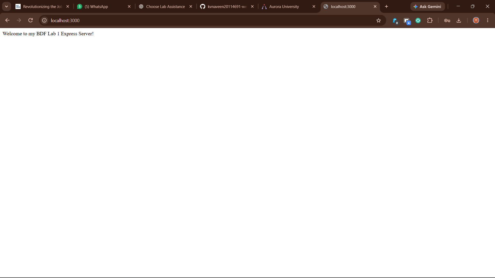
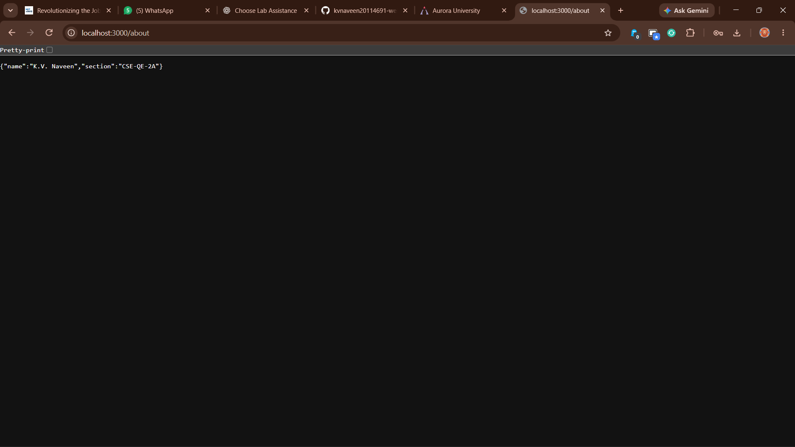
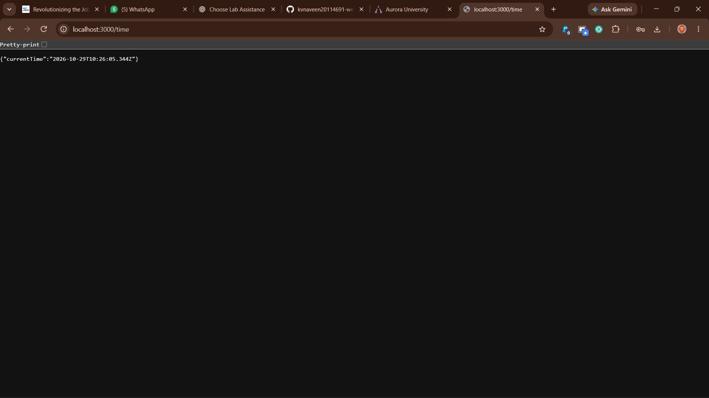
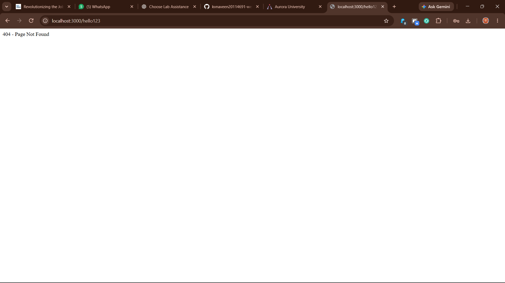

# Lab 1: Node.js and Express Server

## Student Details

- **Name:** K.V. Naveen
- **Registration Number:** 252U1R8037
- **Section:** [CSE-QE-2A]
- **Course:** Backend Development Fundamentals
- **Institution:** Aurora University

## Objective

To create a web server using the built-in Node.js HTTP module and then rewrite it using Express.js. The server provides a welcome message, student information, current date and time, and a 404 response for unknown routes.

## Technologies Used

- Node.js
- Express.js
- JavaScript
- Visual Studio Code
- npm (Node Package Manager)

## Project Structure

```text
BDF_Lab_01/
├── screenshots/
│   ├── 01-welcome.png
│   ├── 02-about.png
│   ├── 03-time.png
│   └── 04-not-found.png
├── node_modules/
├── app.js
├── server.js
├── package.json
├── package-lock.json
├── .gitignore
└── README.md
```

## Installation and Execution

### Prerequisites

Install Node.js and npm.

### 1. Install dependencies

Open the terminal in the project directory and run:

```bash
npm install
```

### 2. Run the Node.js HTTP server

```bash
node server.js
```

The server responds with `Hello` at:

`http://localhost:3000`

Stop this server with `Ctrl + C` before starting the Express server.

### 3. Run the Express server

```bash
node app.js
```

Open the following URL in your browser:

`http://localhost:3000`

## Endpoints

| HTTP Method | Endpoint | Description | Expected Status |
|---|---|---|---|
| GET | `/` | Displays the welcome message | 200 OK |
| GET | `/about` | Returns the student's name and section in JSON format | 200 OK |
| GET | `/time` | Returns the current date and time in JSON format | 200 OK |
| GET | `/hello123` | Demonstrates 404 handling for an unknown route | 404 Not Found |

## Screenshots

### 1. Welcome Route

Displays the welcome message from the Express server.



### 2. About Route

Displays the student's name and section as JSON.



### 3. Time Route

Displays the current date and time.



### 4. 404 Error Handling

Demonstrates the response returned for an unknown route.



## Concepts Learned

- Initializing a Node.js project using `npm init -y`.
- Understanding `package.json` and `node_modules`.
- Creating a server using Node.js's built-in HTTP module.
- Installing and using Express.js.
- Defining GET routes with `app.get()`.
- Using request (`req`) and response (`res`) objects.
- Returning JSON responses with `res.json()`.
- Using HTTP status codes.
- Handling unknown routes with a 404 response.

## Problems Faced and Solutions

### 1. PowerShell Execution Policy

**Problem:** PowerShell blocked the `npm.ps1` script because script execution was disabled.

**Solution:** Used `npm.cmd` to execute npm commands without changing the PowerShell execution policy.

### 2. Port 3000 Already in Use

**Problem:** The previous Node.js server was already using port 3000.

**Solution:** Stopped the previous server process before starting the Express server.

## Conclusion

Successfully created and tested a basic HTTP server using Node.js and an Express server with the required routes. Verified the welcome, about, and time endpoints, and implemented 404 error handling for unknown routes. This lab provided practical experience with server creation, routing, HTTP responses, and npm package management.

## Repository

**GitHub Repository:** [https://github.com/kvnaveen20114691-web/backend-development-fundamentals]

**Live Deployment:** Not deployed yet. The application currently runs locally at `http://localhost:3000`.
